# VaultTrust — architecture

Step-up authentication for high-value bank transfers, built from the project's components:

| Component | What it does | Code |
|---|---|---|
| 1 · Spatial + frequency FAS | Dual ResNet-18 (RGB face ‖ FFT spectrum) → fused → REAL/SPOOF | `spatial_frequency_model.py`, `frequency_transform.py`, `fas_engine.py`, `training/train_fas_v2.py` |
| 2 · Passive liveness | Median score over 10 neutral frames, threshold calibrated on validation | `fas_engine.assess_frames` |
| 3 · Active liveness | 2 random challenges vs. the user's own neutral pose (MediaPipe pose matrix + blendshapes) | `liveness_engine.py` |
| 4 · Explainable AI | Grad-CAM (both branches), branch attribution, radial spectrum, HF energy, fractal dimension, liveness timeline | `fas_engine.explain`, `explainability/`, `ui_components.py` |
| Face recognition | RetinaFace + aligned ArcFace (buffalo_l) | `face_engine.py` |
| Template protection | Chaos-keyed (logistic map) permutation + 512→256 orthonormal projection; cancelable, unlinkable | `biometric_template.py` |
| Second factor | Random-walk OTP v2, transaction-bound, computed offline on the phone | `semprojOTP/otp_system/walk_otp.py`, `authenticator/` |

## Flows

```mermaid
flowchart TD
    subgraph ENROL[Sign up]
        E1[Email code] --> E2[Active liveness + passive FAS]
        E2 -->|REAL| E3[ArcFace embedding] --> E4[Cancelable template<br/>key-seeded chaotic projection]
        E4 --> E5[Pair phone: QR carries secret K once] --> E6[Confirm first OTP]
    end
    subgraph LOGIN[Sign in]
        L1[Liveness + FAS + template match] --> L2[Session]
    end
    subgraph STEPUP[Transfer >= $1,000]
        S1[Fresh liveness + FAS + template match] -->|pass| S2[QR with tx: ref, amount, payee]
        S2 --> S3[Phone: OTP = walk HMAC K, T, SHA256 context]
        S3 --> S4[Server recomputes, T±1, replay check] --> S5[Settle + audit]
        S1 -->|fail| X[Block + evidence in security log]
    end
```



## Decision fusion

`passed = liveness_passed AND fas_real_prob >= threshold AND match_score >= 0.40 AND face_found`

Every rejection carries machine-generated reasons (which check failed, which FAS branch drove it,
how far the high-frequency energy is from live faces), stored with the transaction.

## Random-walk OTP v2

```
seed   = HMAC-SHA256(K, T_be64 || SHA256(context))       T = floor(unix / 30)
stream = SHA256(seed || 0) || SHA256(seed || 1) || ...    (rejection sampling, no modulo bias)
path   = 16-step walk on a fixed 64-node Watts-Strogatz graph (graph also built from SHA-256)
code   = RFC4226-truncate(SHA256("walk-otp-v2|" || path)) mod 10^6
context = "" (login / pairing)  |  "TX|ref|amount_cents|payee" (dynamic linking)
```

Pinned by `semprojOTP/otp_system/tests/walk_otp_vectors.json`; `test_vectors.py` checks Python and
the phone's JavaScript produce identical graphs, paths and codes.

## Data at rest (`vaulttrust.db`)

* `users`: protected template (256-D), template key + OTP secret (Fernet, master key in `db_key.key`),
  balance, device_paired
* `transactions`: ref, parties, amount, status, evidence JSON
* `audit`: security log shown on the dashboard
* `used_otps`: accepted (scope, time-step) pairs — replay protection
