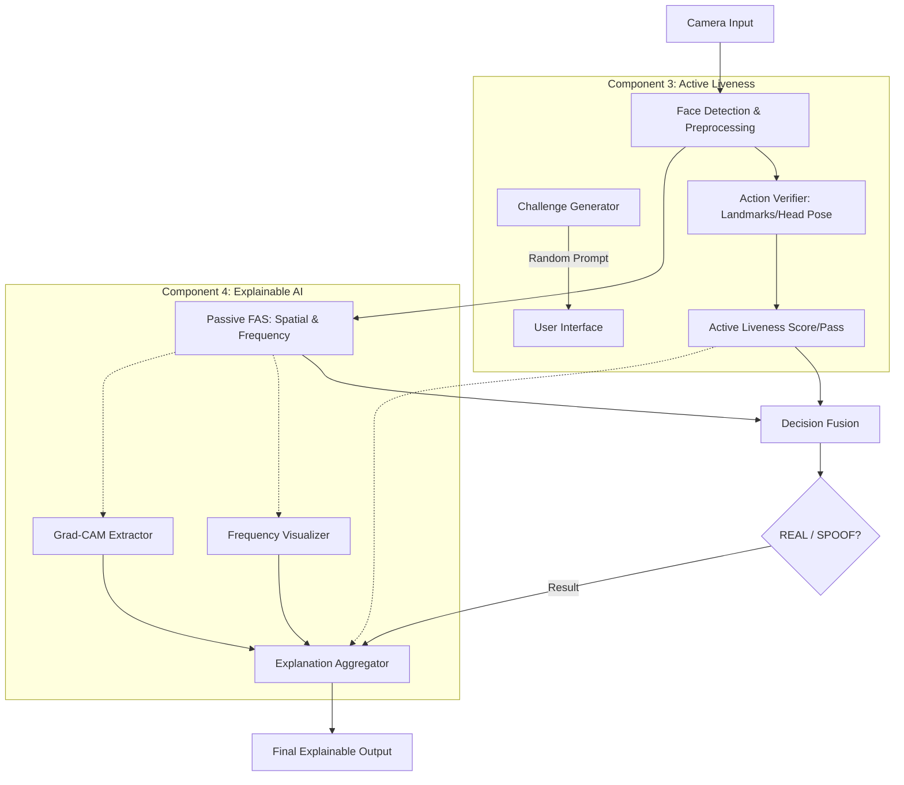
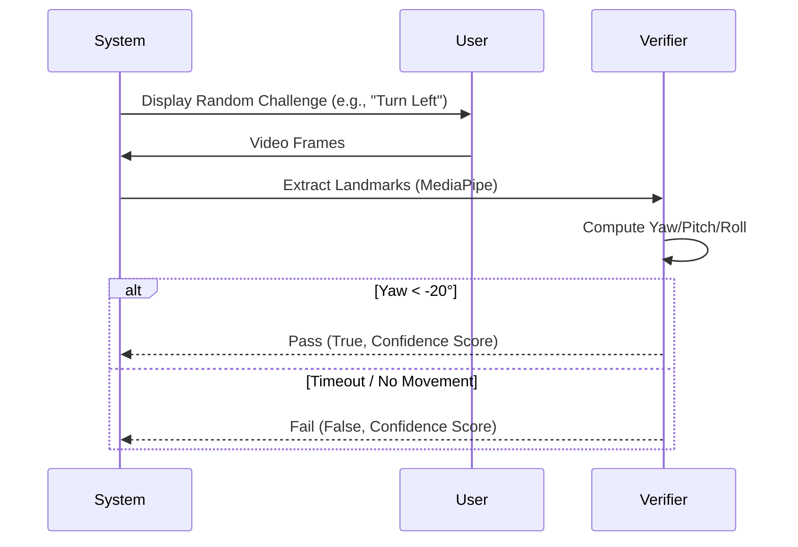
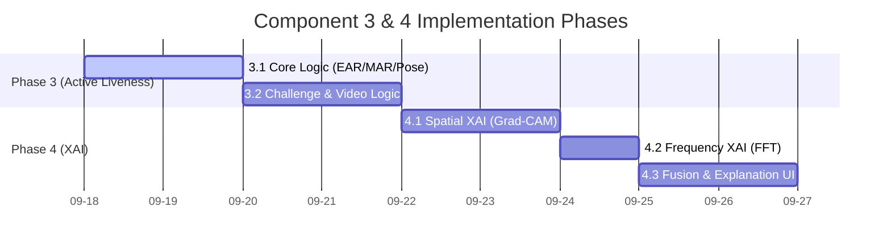

# Architecture Document: Face Anti-Spoofing (Components 3 & 4)

This document details the architectural design for **Component 3 (Active Liveness Detection)** and **Component 4 (Explainable AI)** of the Face Anti-Spoofing (FAS) system. These components augment the core spatial-frequency passive liveness system to provide enhanced security and interpretability.

## 1. System Overview

The overall FAS system sits between the camera and the face recognition module. While Components 1 & 2 handle passive spatial and frequency analysis, Components 3 & 4 provide:
- **Active Liveness:** Interactive challenge-response mechanism to thwart static replays and deepfakes.
- **Explainability (XAI):** Transparent decision-making evidence, exposing *why* a presentation was classified as genuine or spoof.

## 2. Component 3: Active Liveness Detection

The active liveness module introduces a randomized challenge-response protocol.

### 2.1 Architecture
- **Challenge Generator (`challenge.py`)**: Randomly selects a challenge (Blink, Turn Left/Right, Smile, Look Up/Down) to prevent attackers from predicting the required action.
- **Action Verifier**: Analyzes a short video sequence (or frame buffer) to verify compliance with the challenge.
  - **Blink Detector (`blink.py`)**: Computes the Eye Aspect Ratio (EAR) from eye landmarks. A blink is detected when EAR drops below a threshold and recovers.
  - **Head Pose Estimator (`head_pose.py`)**: Calculates Yaw, Pitch, and Roll using facial landmarks to verify directional head movements.
  - **Smile Detector (`smile.py`)*: Uses mouth landmarks (Mouth Aspect Ratio - MAR) or an expression model to detect smiling.

### 2.2 Data Flow

## 3. Component 4: Explainable AI (XAI)

The XAI component interprets the model's decision and formats it for human understanding.

### 3.1 Architecture
- **Grad-CAM Extractor (`gradcam.py`)**: Hooks into the final convolutional layer of the Spatial Encoder (e.g., ResNet-18) to generate a heatmap highlighting regions of interest (e.g., screen edges, moiré patterns).
- **Frequency Explanation (`frequency_explanation.py`)**: Visualizes the FFT/DWT spectrum or highlights anomalous high-frequency bands that influenced the frequency branch.
- **Explanation Aggregator (`explanation.py`)**: Collects signals from the passive model, active verifier, and visual explainers to construct a comprehensive evidence report.

### 3.2 Output Structure
The aggregated explanation consists of:
1. **Decision**: REAL / SPOOF
2. **Confidence**: Probability score (e.g., 96.2%)
3. **Evidence List**:
   - Spatial anomaly detected (Yes/No) + Grad-CAM Heatmap
   - Frequency anomaly detected (Yes/No) + Spectrum Visualization
   - Active challenge passed (Yes/No)
4. **Reasoning**: A heuristic-based conclusion (e.g., "Likely replay attack due to challenge failure and screen-edge artifacts").

## 4. Phase-Wise Development Flow

According to the project brief's overall timeline, this architecture will be realized across two primary phases:

### Phase 3: Active Liveness Deployment
- **Phase 3.1: Core Geometry & Verification (EAR/MAR/Pose)**
- **Phase 3.2: Challenge Sequence & Video Frame Handling**

### Phase 4: Explainable AI Deployment
- **Phase 4.1: Spatial Hooking & Grad-CAM Extraction**
- **Phase 4.2: Frequency Visualization**
- **Phase 4.3: Final Evidence Fusion & UI Formatting**

## 5. Integration Strategy

To ensure seamless integration with Components 1 & 2 (being developed by other team members):
- **Interfaces**: We will define strict Python interfaces/abstract base classes for the liveness verifiers and explanation generators.
- **Shared Dependencies**: We will standardize on **MediaPipe** for facial landmarks, as it is efficient and covers blink (EAR), head pose, and smile (MAR).
- **Decoupling**: The XAI module will accept generic feature maps and gradients, ensuring it remains agnostic to the specific architecture chosen for the Spatial/Frequency encoders (whether ResNet, EfficientNet, etc.).
